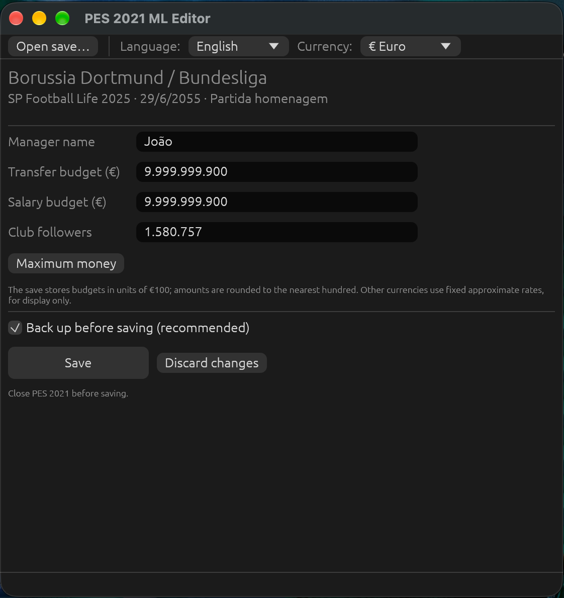

<p align="center">
  
</p>

<h1 align="center">PES 2021 ML Editor</h1>

<p align="center">
  Open-source, cross-platform editor for <b>eFootball PES 2021</b> Master League saves.
</p>

Everything runs in memory with no helper programs, and every change is verified before and
after saving.

<p align="center">
  
</p>

## Features

* Transfer budget and salary budget, plus a one-click **Maximum money**
* Club followers
* Manager name (found automatically, also in patched databases)
* Display in € / US$ / ¥ / £ / R$
* Desktop app in English, Spanish and Brazilian Portuguese (follows the system language), with drag and drop
* Command-line tool for scripting (`show`, `set`, `decrypt`, `encrypt`)
* Windows, Linux and macOS (Intel and Apple Silicon)

## Download

Get the latest version from the **Releases** page:

| System | File | Guide |
|---|---|---|
| Windows 10/11 (64-bit) | `pes21-ml-editor-<version>-windows-x86_64.zip` | [Install on Windows](docs/INSTALL-WINDOWS.md) |
| macOS, Apple Silicon (M1…) | `pes21-ml-editor-<version>-macos-aarch64.dmg` | [Install on macOS](docs/INSTALL-MACOS.md) |
| macOS, Intel | `pes21-ml-editor-<version>-macos-x86_64.dmg` | [Install on macOS](docs/INSTALL-MACOS.md) |
| Linux (x86-64) | `pes21-ml-editor-<version>-linux-x86_64.tar.gz` | [Install on Linux](docs/INSTALL-LINUX.md) |

Every release includes `SHA256SUMS.txt` and a build provenance attestation
(`gh attestation verify <file> --repo <owner>/pes21-ml-editor`).

## Quick start

1. **Quit Master League.**
2. Open the editor and choose your save, e.g.
   `Documents\KONAMI\eFootball PES 2021 SEASON UPDATE\<your ID>\ML00000001`.
3. Change the values and click **Save**. A timestamped backup is created first.

Full instructions, including the command line: [docs/USAGE.md](docs/USAGE.md).

## Keeping your saves safe

* A save is only editable if re-encrypting it unchanged reproduces the file byte for byte.
* Only the bytes of the fields you change are written.
* A backup is made before every save and is never overwritten.
* Writing is atomic (temporary file + rename); if the final check fails, the previous
  contents are restored automatically.
* If the game writes the save while you are editing, nothing is written.
* The editor never connects to the internet and runs no other programs.

## Building from source

Requires Rust 1.95+ ([rustup.rs](https://rustup.rs)).

```bash
cargo build --release --locked
cargo test --workspace
```

Binaries are placed in `target/release/` (`pes21-ml-editor` and `pes21-ml`).

On a Mac, `scripts/build-macos.sh` builds the `.app` and `.dmg` in `dist/`
(see [Building on a Mac](docs/INSTALL-MACOS.md#building-on-a-mac)).

| Folder | Contents |
|---|---|
| `crates/core` | library: save encryption, Master League fields, safe saving |
| `crates/cli` | `pes21-ml` command-line tool |
| `crates/gui` | `pes21-ml-editor` desktop app (egui) |
| `assets/` | icon sources and platform packaging files |
| `scripts/` | `build-macos.sh`: local macOS app and disk image |
| `docs/` | installation guides, user guide and [save format](docs/SAVE_FORMAT.md) |

## Credits

* Save encryption is based on the public-domain
  [pesXdecrypter](https://github.com/the4chancup/pesXdecrypter) project, with the PES 2021
  key published by *zlac*.
* Master League field positions follow those used by *PES 2021 ML Money Tool* by
  *Devil Cold52*.

Unofficial project, not affiliated with KONAMI. "eFootball" and "PES" are trademarks of
KONAMI. Only use it on your own saves, offline, and keep backups.

## License

Dual-licensed under [MIT](LICENSE-MIT) or [Apache-2.0](LICENSE-APACHE), at your option.
See also [THIRD_PARTY_NOTICES.md](THIRD_PARTY_NOTICES.md).
